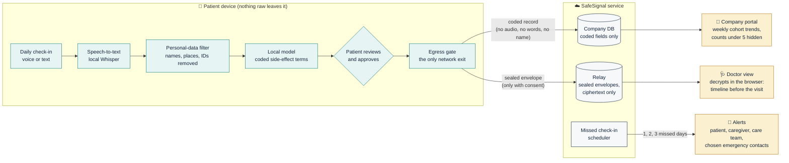
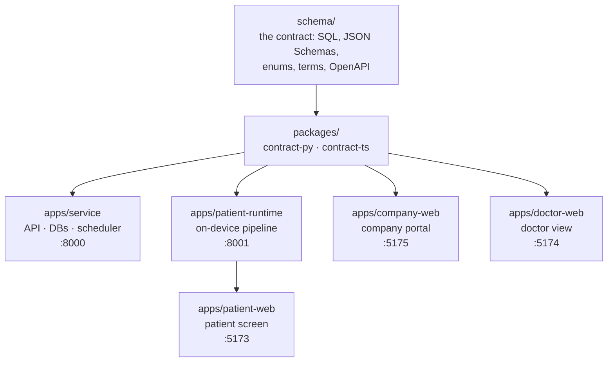

<div align="center">

<picture>
  <source media="(prefers-color-scheme: dark)" srcset="docs/brand/logo-dark.png">
  
</picture>

**Daily side-effect check-ins that stay on the patient's phone.**

Patients report side effects by voice or text, and everything is processed on their device.<br>
Doctors get a consent-based symptom timeline before each visit. Drug companies get minimal, structured side-effect data by drug version and cohort.

[](https://github.com/Poornimatagaram/SafeSignal/actions/workflows/ci.yml)


[](LICENSE)

Built at **HACK1984** · Privacy-First track

</div>

---

## Demo

<div align="center">

[](https://youtu.be/cJERNi1LbZQ)

**[▶ Watch the demo on YouTube (2:15)](https://youtu.be/cJERNi1LbZQ)**

</div>

<sub>Part 1 (0:00-1:01): the problem, with patient, doctor and drug company each failing quietly. Part 2 (1:01-2:15): one morning with SafeSignal from start to finish. Every person, company and hospital in the video is fictional.</sub>

## How it works



| Who | What they get | How privacy is kept |
| --- | --- | --- |
| **Patient** | A daily check-in by voice or text, plus a receipt for every send | Speech-to-text, filtering and extraction all run on the device. The patient approves every send, and each receipt carries a hash the service echoes back |
| **Doctor / hospital** | The patient's symptom timeline before each visit | Sealed on the device to the organization's care-team key (libsodium sealed box), so the service stores only ciphertext. Access requires consent and can be revoked |
| **Drug company** | Structured side-effect data by drug, cohort and ISO week | Coded fields only, with no free text. Counts under 5 patients are hidden, and every read and export is logged |
| **Caregiver** | Alerts when check-ins are missed | Alerts carry IDs and a time only, never symptoms |

Full privacy audit: [`docs/privacy-measures.md`](docs/privacy-measures.md).

## Repository map



| Path | What it is | Port |
| --- | --- | --- |
| [`schema/`](schema/) | The contract: SQL, JSON Schemas, enums, terms, OpenAPI, examples, demo fixtures | — |
| [`packages/contract-py/`](packages/contract-py/) | Python `sentinel_contract`: hashing, validation, `SentinelClient` | — |
| [`packages/contract-ts/`](packages/contract-ts/) | npm `@sentinel/contract`: hashing, generated API types | — |
| [`apps/service/`](apps/service/) | Company DB, relay store, API and missed check-in scheduler | 8000 |
| [`apps/patient-runtime/`](apps/patient-runtime/) | On-device speech-to-text, personal-data filter, local model, egress gate | 8001 |
| [`apps/patient-web/`](apps/patient-web/) | Patient check-in screen | 5173 |
| [`apps/doctor-web/`](apps/doctor-web/) | Doctor view; keys stay in the browser (IndexedDB) | 5174 |
| [`apps/company-web/`](apps/company-web/) | Company portal | 5175 |
| [`evals/`](evals/) | Leakage, F1 and access evaluations | — |
| [`data/`](data/) | Public data (openFDA cache) and synthetic generators | — |
| [`scripts/`](scripts/) | Shared tooling: reset, demo envelope sender, end-to-end check | — |
| `var/` | All runtime databases (gitignored) | — |

Code and packages use the working name **Sentinel** (`sentinel_*`, `@sentinel/*`, `SENTINEL_*`); see [`docs/DECISIONS.md`](docs/DECISIONS.md) D-040.

## Quick start

Requires [uv](https://docs.astral.sh/uv/) and Node.js.

```bash
# Service (API docs at http://127.0.0.1:8000/docs)
cd apps/service && uv sync
uv run python -m sentinel_service.seed                # synthetic demo data; safe to re-run
uv run uvicorn sentinel_service.main:app --port 8000

# Company portal (http://localhost:5175)
cd apps/company-web && npm install && npm run dev

# Start clean from the repo root: wipe var/ and reseed
scripts/reset_all.sh --seed
```

Each app has its own setup in its folder (`README.md` or `CLAUDE.md`). Hosted version on Render's free tier: [`render.yaml`](render.yaml) and [`docs/DEPLOY.md`](docs/DEPLOY.md).

## Checks

```bash
(cd packages/contract-py && uv run pytest -q)
(cd apps/service && uv run pytest -q)
npm test --prefix packages/contract-ts
uv run --project apps/service python scripts/e2e_check.py   # one check-in through every persona on a throwaway service
```

## Documentation

| Document | What it covers |
| --- | --- |
| [`docs/scoping-document.md`](docs/scoping-document.md) | Full scope and design |
| [`docs/DECISIONS.md`](docs/DECISIONS.md) | Decisions; these override the scoping document |
| [`docs/INTEGRATION_STATUS.md`](docs/INTEGRATION_STATUS.md) | What the service does today, endpoint by endpoint |
| [`docs/privacy-measures.md`](docs/privacy-measures.md) | What leaves the device, who can read it, and how we prove it |
| [`CONTRIBUTING.md`](CONTRIBUTING.md) | Branches, Conventional Commits and the pull-request flow |
| `apps/<app>/CLAUDE.md` | Full brief for each app, for people and coding agents |

## Data and security

Synthetic data only. All people, hospitals and the drug company Halvaren Therapeutics are fictional; side-effect rates are modelled on public trial arms. There is no cloud speech, no cloud AI on patient data, and no analytics or tracking. Databases, keys and audio are never committed.

## License

[MIT](LICENSE)
