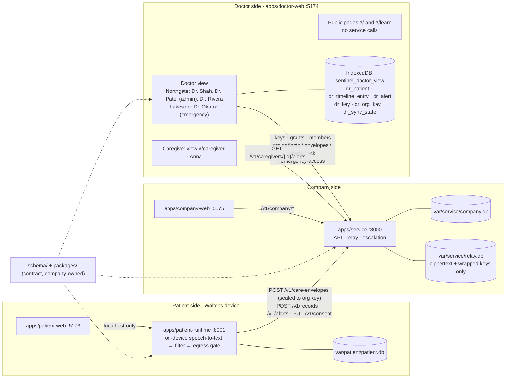
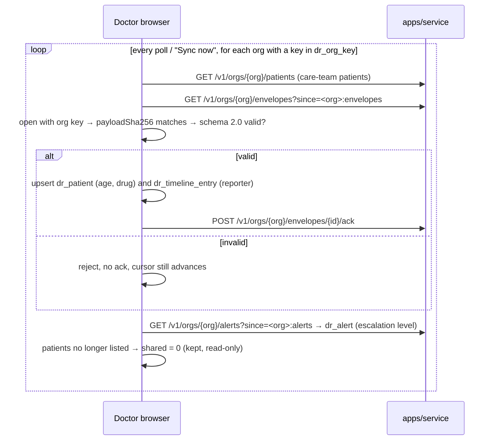

# Architecture: apps/doctor-web (contract 2.2)

How the doctor and caregiver views fit into the SafeSignal repo. Names, ports and calls match `README.md`, `CODEOWNERS`, `schema/`, `docs/briefs/doctor-web.md` and `docs/design/contract-2.0.md`. If this file disagrees with them, they win.

## 1. Whole system



Privacy line: the service only holds ciphertext and wrapped keys. Organization private keys exist only in member doctors' browsers (`dr_org_key`); nothing decrypted leaves the browser.

## 2. Keys: how a doctor gets to read an organization's records

```mermaid
sequenceDiagram
  participant M as Member doctor's browser (e.g. Dr. Shah)
  participant A as Admin's browser (Dr. Patel)
  participant S as apps/service
  M->>M: first launch: personal X25519 pair → dr_key
  M->>S: PUT /v1/doctors/{me}/public-key
  A->>A: once per org: org key pair → dr_org_key
  A->>S: PUT /v1/orgs/{org}/public-key
  M-->>A: member's public key (copied by hand in the demo; no lookup endpoint yet)
  A->>A: crypto_box_seal(org private key, member public key)
  A->>S: POST /v1/orgs/{org}/key-grants {doctor_id, wrapped_key}
  M->>S: GET /v1/orgs/{org}/key-grants/{me}
  M->>M: crypto_box_seal_open → dr_org_key
  Note over A,S: Doctor change: admin PUTs members/{old} status "revoked" (grant deleted), grants the new doctor, who reads the full history.
```

## 3. Sync, per organization



Emergency organizations (Lakeside) do not sync routinely. A member states a coded reason, `POST /v1/orgs/{org}/emergency-access` returns the envelopes, and the app shows an "Emergency access" banner with the reason. The service logs it and notifies Anna and Northgate.

## 4. Inside the app

See `README.md` §10–§13 for the current screens, routes, Guided and Clinic views, code structure and browser data, each with a diagram.

## 5. What is on `main`

| Pull request | Contents |
|---|---|
| #8 | Vite/React/TS setup, secret check, app docs |
| #9 | `src/lib/`: keys, grants, per-org sync, IndexedDB 2.0 |
| #16 | `evals/doctor/`: 26.15 access and privacy checks (19/19 on contract 2.2) |
| #17 | `data/doctor/`: synthetic 3-week demo history |
| #18 | Key grant made in another browser no longer blanks every organization |
| #28 | Doctor UI (DW-29): home, patients, detailed view, guide, Admin & access, caregiver view, emergency access, light/dark/system |
| #30 | Accessibility pass (DW-31) |
| #35 | Clinic view (DW-32) |

New work goes on a `doctor/<type>/<topic>` branch from `main` and into a pull request (CONTRIBUTING).
