# Doctor web (`apps/doctor-web`)

The doctor's side of SafeSignal. A care team reads its patients' side-effect check-ins, and the alerts about them, before each visit. Every check-in arrives sealed to the care team's key and is opened only in the doctor's browser. The service relays ciphertext and can never read it.

| | |
|---|---|
| **Owner** | Doctor side (`CODEOWNERS`: `apps/doctor-web/`, `evals/doctor/`, `data/doctor/`) |
| **Package** | `@sentinel/doctor-web` · Vite, React 19, TypeScript, Tailwind 3 |
| **Live** | `https://safesignal-doctor.onrender.com` (Render static site, built from `main`) |
| **Port** | 5174 (`http://127.0.0.1:5174` and `http://localhost:5174`) |
| **Contract** | 2.2, read-only from `schema/` and `packages/contract-ts`; never edit them |
| **Crypto** | `libsodium-wrappers` sealed boxes (X25519), keys in standard base64 |
| **Browser data** | IndexedDB `sentinel_doctor_view`, six stores from `schema/doctor_view.sql` |
| **Brief** | `docs/briefs/doctor-web.md` (company-maintained) · agent notes in `CLAUDE.md` (`AGENTS.md` points to both) |
| **Logs** | `DECISIONS.md` (DW-01…), `CHANGELOG.md`, `SESSION_LOG.md` · demo script in `DEMO.md` · `ARCHITECTURE.md` |
| **Service status** | `docs/INTEGRATION_STATUS.md` · demo IDs in `schema/demo_fixtures.json` |

All patients, doctors and records are synthetic.

---

## Contents
1. [Run it](#1-run-it) · [Deployed on Render](#deployed-on-render)
2. [Where it sits in SafeSignal](#2-where-it-sits-in-safesignal)
3. [The privacy line](#3-the-privacy-line)
4. [From a spoken check-in to the doctor's screen](#4-from-a-spoken-check-in-to-the-doctors-screen)
5. [Keys: how a doctor gets to read a care team's records](#5-keys-how-a-doctor-gets-to-read-a-care-teams-records)
6. [Sync, step by step](#6-sync-step-by-step)
7. [Doctor change](#7-doctor-change)
8. [Emergency access](#8-emergency-access)
9. [Alerts and escalation](#9-alerts-and-escalation)
10. [Screens and routes](#10-screens-and-routes)
11. [Guided and Clinic views](#11-guided-and-clinic-views)
12. [Inside the code](#12-inside-the-code)
13. [Browser data](#13-browser-data)
14. [Theme and accessibility](#14-theme-and-accessibility)
15. [Checks and tests](#15-checks-and-tests)

---

## 1. Run it

```bash
# 1. The service, with both doctor origins allowed (from the repo root)
scripts/reset_all.sh --seed
cd apps/service && SENTINEL_ALLOWED_ORIGINS=http://localhost:5174,http://127.0.0.1:5174 \
  uv run uvicorn sentinel_service.main:app --port 8000

# 2. The doctor app
cd apps/doctor-web
npm install
cp .env.example .env.local      # VITE_DOCTOR_SERVICE_URL=http://127.0.0.1:8000
npm run dev -- --host 127.0.0.1 # http://127.0.0.1:5174
```

| Address | What it is |
|---|---|
| `/#/` | Home: Guided or Clinic view, whichever this browser last chose |
| `/#/patient/<ref>` | Home with that patient open |
| `/#/patient/<ref>/record` | Detailed view: check-in log, alert history, sharing and access, field meanings, screen map |
| `/#/guide` | Field meanings and screen map, for every patient |
| `/#/admin` | Admin & access: care-team keys, members, emergency access, reset this browser |
| `/#/caregiver` | Anna's caregiver view (alerts only, never symptoms) |
| `/#/about`, `/#/learn` | Patient-facing pages; no service calls |

Each browser profile holds one doctor (DW-19). For the demo, use a separate Chrome profile per doctor (`DEMO.md`).

Changed `tailwind.config.js`? Restart `npm run dev`; the dev server does not reload it.

### Deployed on Render

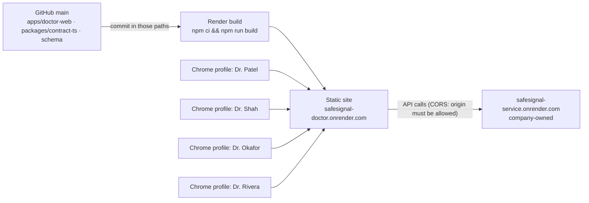

| Render setting | Value |
|---|---|
| Type | Static Site, repo `Poornimatagaram/SafeSignal`, branch `main` |
| Root directory | `apps/doctor-web` |
| Build command | `npm ci && npm run build` (includes the secrets check) |
| Publish directory | `dist` |
| Environment | `VITE_DOCTOR_SERVICE_URL=https://safesignal-service.onrender.com` (no trailing slash) · `NODE_VERSION=22` |
| Build filters | `apps/doctor-web/**`, `packages/contract-ts/**`, `schema/**` |
| Rewrite | `/*` → `/index.html` |

- **One address, many doctors:** each doctor uses a separate Chrome profile on the same address; browser storage, and so the keys, is per profile (DW-19, DW-33).
- **Allowed origin:** the company owner lists `https://safesignal-doctor.onrender.com` in the service's `SENTINEL_ALLOWED_ORIGINS` (`docs/DEPLOY.md`). Check it with:
  ```bash
  curl -si -X OPTIONS https://safesignal-service.onrender.com/v1/terms \
    -H "Origin: https://safesignal-doctor.onrender.com" -H "Access-Control-Request-Method: GET" | grep -i access-control-allow-origin
  ```
- **`VITE_*` values are baked in at build time:** after changing one, use **Manual Deploy → Deploy latest commit**, not a restart.
- **Free tier:** the service sleeps after 15 idle minutes (the first call takes about 50 s; open `/healthz` a minute before a demo). Every service restart or deploy resets its data, so each doctor profile then uses **Reset this browser** and redoes the key setup.
- **Demo day:** set Auto-Deploy to **Off** so the site can't change mid-demo, and merge nothing to `main` in the last hour.

---

## 2. Where it sits in SafeSignal

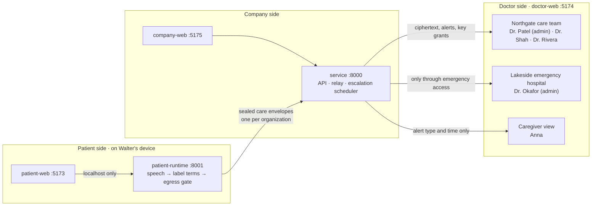

---

## 3. The privacy line

The service stores and relays envelopes it cannot open. Private keys never leave the browsers that hold them.

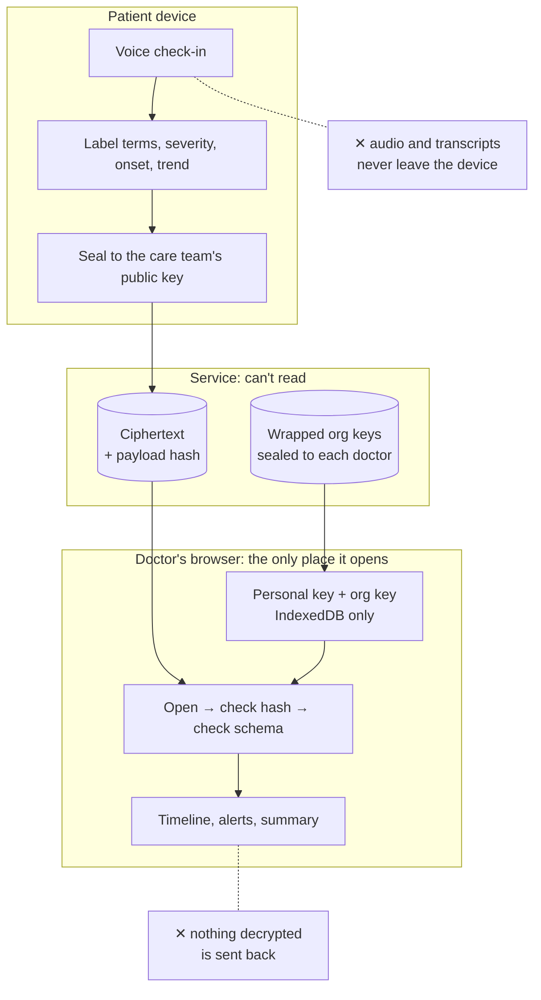

| Never leaves the patient's device | Never leaves the doctor's browser | Never in this app |
|---|---|---|
| Audio, transcripts, everyday words | Personal and org private keys, decrypted check-ins | Cloud AI on patient data, analytics, tracking, third-party fonts |

---

## 4. From a spoken check-in to the doctor's screen

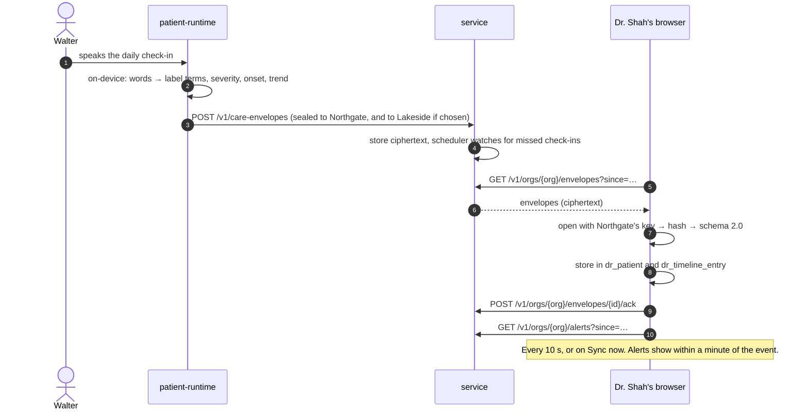

---

## 5. Keys: how a doctor gets to read a care team's records

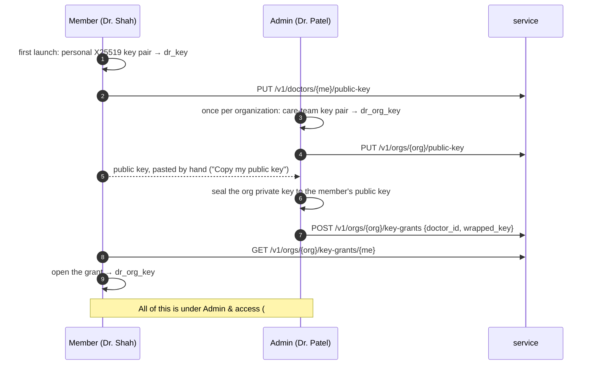

How a hospital's key status reads in the top bar's hospital menu:

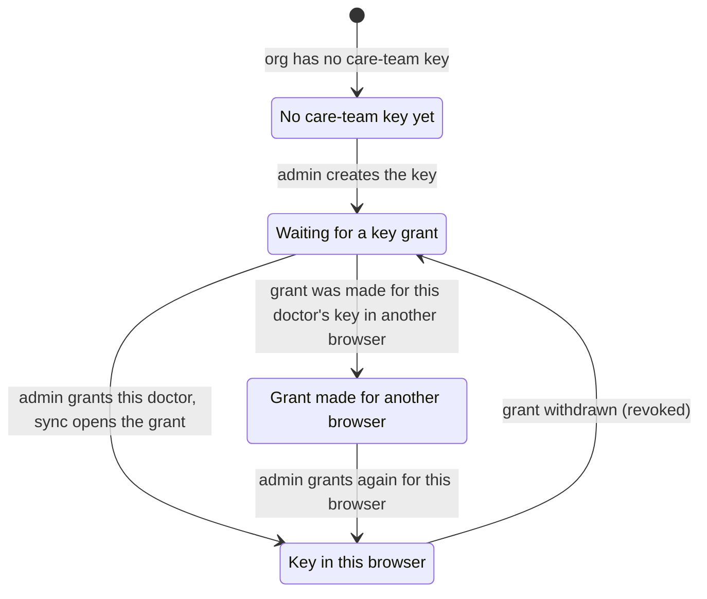

---

## 6. Sync, step by step

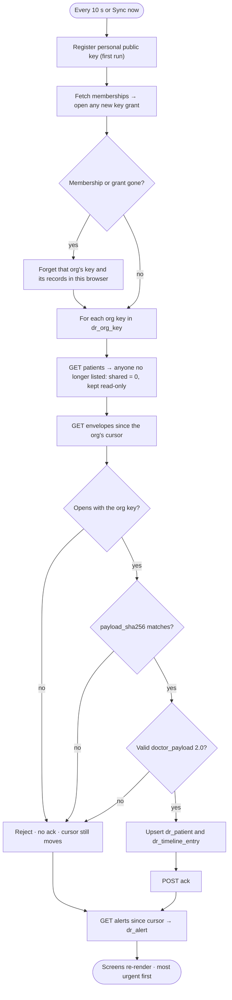

Rejection reasons are shown as a count ("n check-ins failed the safety checks") and never include decrypted content.

---

## 7. Doctor change

The record belongs to the care team, so the next doctor sees the full history and the one who left sees nothing.

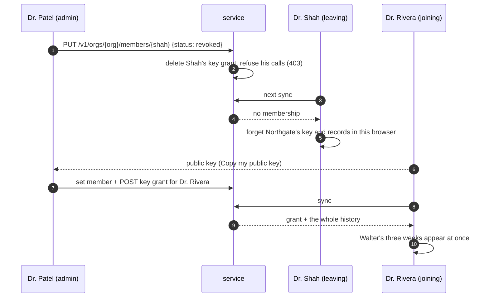

---

## 8. Emergency access

For an emergency hospital the patient chose at setup (Lakeside for Walter). It never reads routinely.

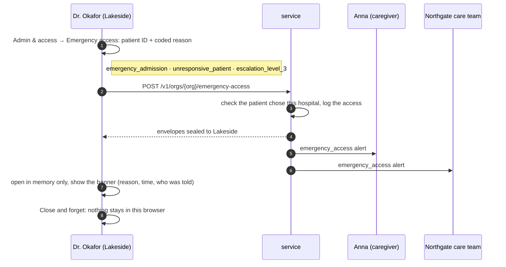

---

## 9. Alerts and escalation

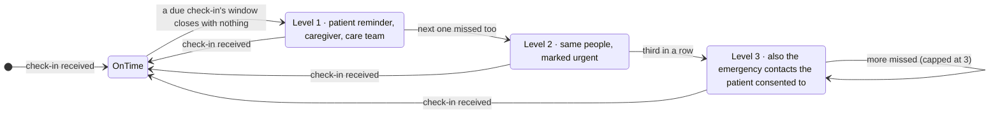

| Alert | Who is told (D-068) | Shown as |
|---|---|---|
| Missed check-in, level 1–2 | Patient (reminder), caregiver, care team | Clock icon, level bars |
| Missed check-in, level 3 | The same people, plus consented emergency contacts | Urgent, most urgent first |
| Severe symptom | Caregiver and care team | Warning icon, top of the queue |
| Emergency access | Caregiver and care team | Logged; shown on the patient's record |

The app shows these rules; it does not receive delivery records. Alerts are for the doctor's review and never diagnose.

---

## 10. Screens and routes

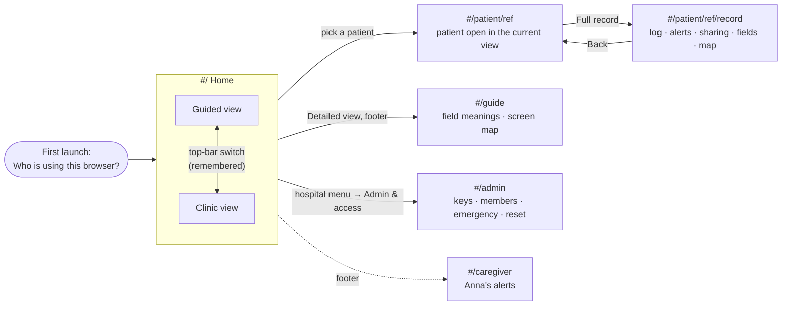

---

## 11. Guided and Clinic views

Two views of the same app (DW-32): same data, sync and components, so they can't drift apart.

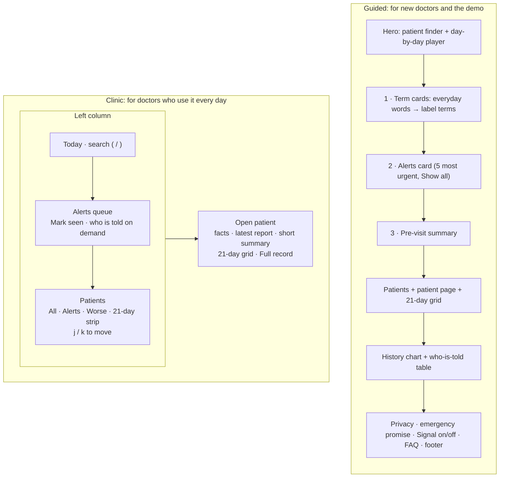

| Kept in Clinic | Only in Guided (and the Guide page) |
|---|---|
| Top bar: hospital, sync, appearance, view switch | Section links, hero, day-by-day player |
| Alerts queue with Mark seen | Term cards, numbered steps, arrow connectors |
| Patient list with a 21-day strip | Promise strip, access-checks card |
| Open patient: facts, latest report, summary, grid | Symptoms chart, who-is-told table |
| Full record, Admin & access | Privacy, emergency promise, Signal on/off, FAQ, footer |

On phones the view switch moves into the ☰ menu, next to Appearance.

---

## 12. Inside the code

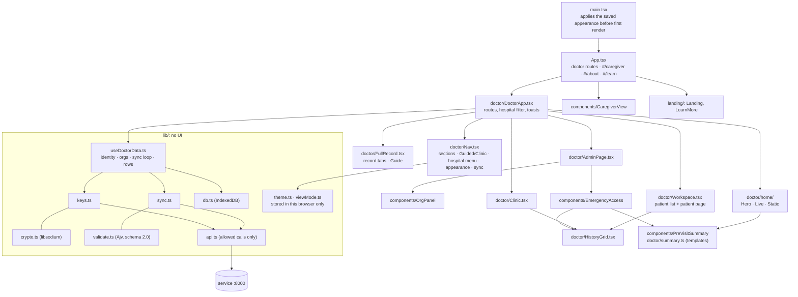

| Folder | Holds |
|---|---|
| `src/lib/` | Keys, crypto, sync, validation, API client, IndexedDB, appearance and view mode. No UI. |
| `src/doctor/` | Doctor screens, the display model (`model.ts`), routes, icons, the template summary. |
| `src/components/` | Shared pieces: identity picker, org panel, emergency access, pre-visit summary, caregiver view. |
| `src/landing/` | Patient-facing pages; static, no service calls. |
| `src/theme.css` | Theme tokens (light, dark) and the doctor screens' styles. Tailwind colours point at the same tokens. |

---

## 13. Browser data

IndexedDB `sentinel_doctor_view`, one store per table in `schema/doctor_view.sql`. "Reset this browser" (Admin & access) deletes all of it.

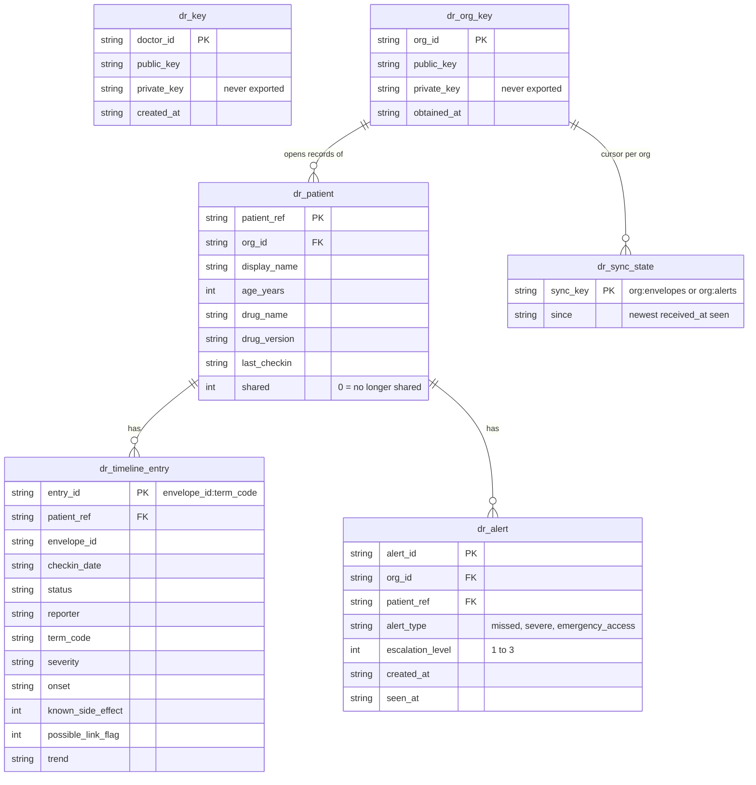

Emergency-access data is never written here; it lives in memory until "Close and forget" (DW-21).

---

## 14. Theme and accessibility

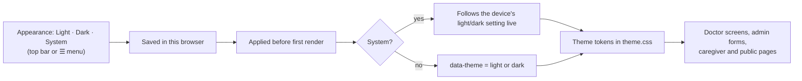

| Rule | How it's met |
|---|---|
| Text contrast 4.5:1 (3:1 for large text) | Light and dark tokens measured; rendered-page audit: 0 failures (DW-31) |
| Not by colour alone | Grid severity is colour **and** fill height (a third, two thirds, full); trend and alerts have words and icons |
| Readable sizes | Smallest text 11 px |
| Tap targets | Controls 24 px or more, grid day buttons spaced |
| Motion | Respects reduced motion; animations are short and optional |
| Keyboard | Visible focus; `/` search and `j`/`k` in Clinic; menus close with Esc |
| Fonts | Fredoka, DM Sans, DM Mono, self-hosted (no font CDN) |

---

## 15. Checks and tests

```bash
npm run lint          # ESLint
npm run build         # type-check + build + scripts/check-secrets.sh
# from the repo root:
uv run --project packages/contract-py python evals/doctor/access_checks.py    # 26.15 access and privacy checks: 19/19 on contract 2.2
uv run --project packages/contract-py python data/doctor/send_demo_history.py # synthetic 3-week history for Walter and Priya
scripts/check_ownership.sh && scripts/check_commits.sh                          # before every push
```

Before each pull request, the app was also checked in a headless browser against an isolated, freshly seeded service (72 checks):
- key setup, grants and sync
- every home section in both views
- patients, the grid and Mark seen
- the record tabs, the guide and admin
- emergency access
- light, dark and system modes
- routing
- no sideways scrolling from 390 to 1920 px
