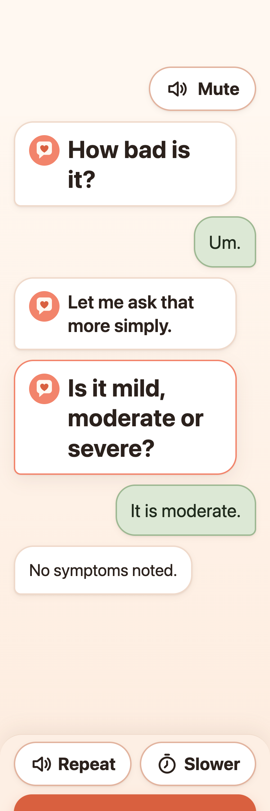
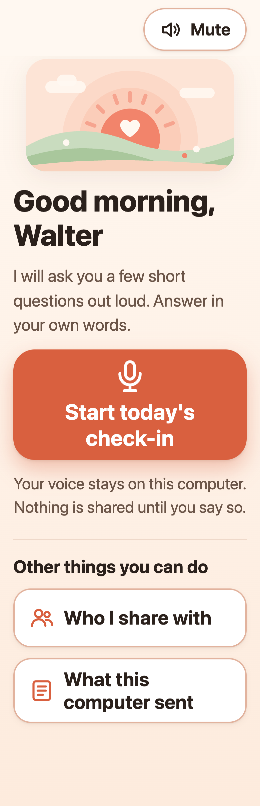
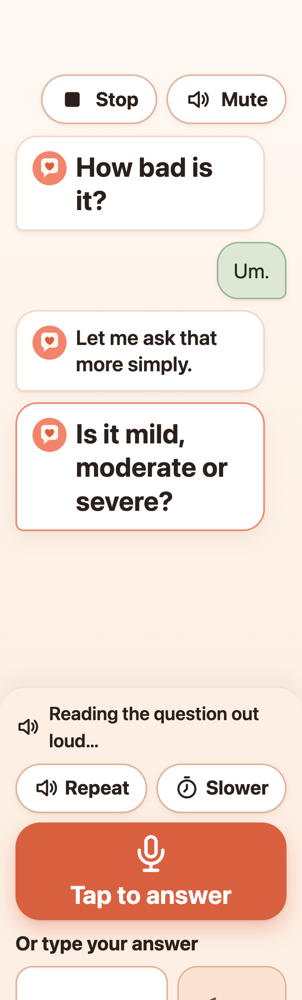
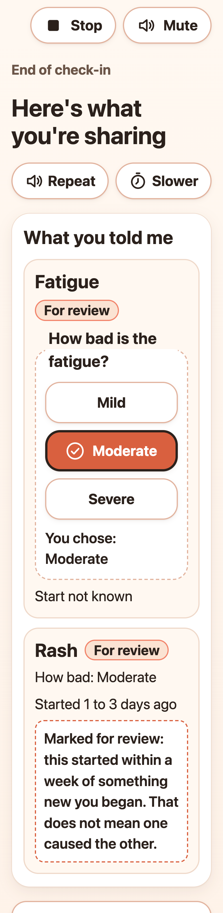
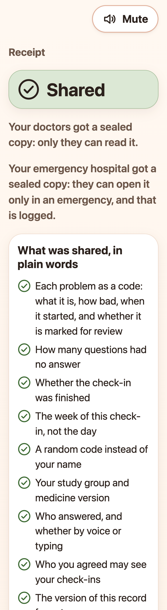
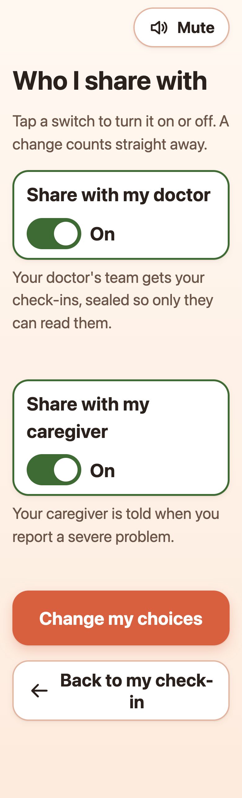
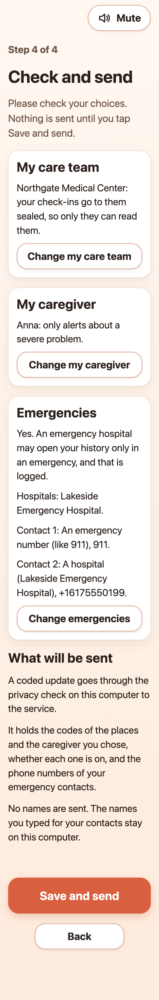
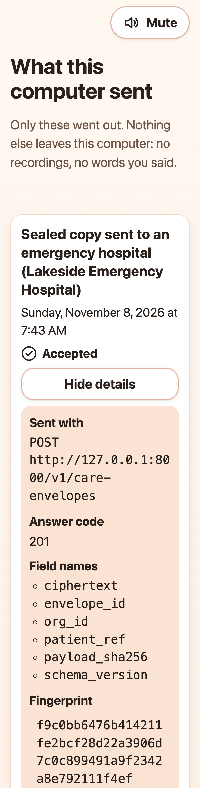
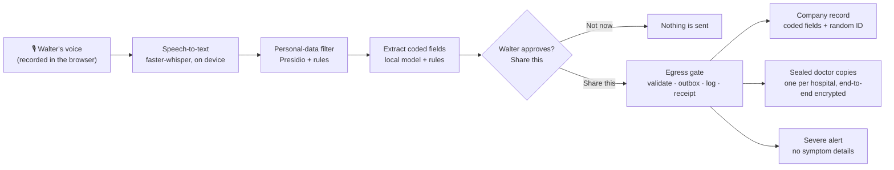

# SafeSignal patient side

Walter, 92, answers a few spoken questions about side effects on his own computer, by voice or by typing. Everything is heard, filtered and coded on the device, and nothing is shared until he taps **Share this**. Then the drug company gets coded answers only, and his care team gets a sealed copy only they can open.

<p align="center">
  
</p>

This README covers both halves of the patient feature: the **runtime** (`apps/patient-runtime`, Python, port 8001), which does the listening, filtering, coding and sending, and the **screen** (`apps/patient-web`, React, port 5173), which Walter sees and talks to. For the demo day checklist, see [`DEMO.md`](DEMO.md).

## The screens

| Home | Check-in chat | Re-ask | Summary |
| --- | --- | --- | --- |
|  |  |  |  |
| **Receipt** | **Who I share with** | **Setup** | **What this computer sent** |
|  |  |  |  |

The screenshots were taken in a headless browser with synthetic data for Walter (`pt_4b82d0c6`). [`before-after.png`](../patient-web/docs/screenshots/before-after.png) compares the old and new look. To retake them, see [`apps/patient-web/docs/screenshots/`](../patient-web/docs/screenshots/).

## How a check-in flows



Speech-to-text, filtering, extraction and text-to-speech all run on this computer. The egress gate is the only code that talks to the network, and only to the Sentinel service.

> [!IMPORTANT]
> **Never leaves the device:** Walter's **audio**, the **transcript**, **his own words**, his **name**, **date of birth** and **phone**. Also never: contact names and descriptions of new things he started. The company record holds only coded fields and a random ID. His name and the exact date travel only inside the sealed copies, which only his care team, or an emergency hospital through logged emergency access, can open.

## Quick start

Setup, once (needs the network; check-ins never do):

```bash
cd apps/patient-runtime && uv sync                         # Python deps, including the spaCy model for the filter
uv run python -m sentinel_patient.stt --download            # Whisper base.en into the local cache
ollama pull llama3.2:3b                                     # the local extraction model (Ollama must be running)
cd ../patient-web && npm ci
```

Start (each in its own terminal, from the repo root):

```bash
(cd apps/service && uv run uvicorn sentinel_service.main:app --port 8000)          # Sentinel service (company)
(cd apps/patient-runtime && uv run uvicorn sentinel_patient.main:app --port 8001)  # runtime, binds 127.0.0.1
(cd apps/patient-web && npm run dev)                                               # screen: http://127.0.0.1:5173
```

| Port | What |
| --- | --- |
| 8000 | Sentinel service: the only place the egress gate sends to |
| **8001** | Patient runtime, on this computer only (loopback) |
| **5173** | Patient screen |
| 11434 | Ollama, the local model (loopback only) |

Settings, CORS origins and the demo-morning checklist are in [`DEMO.md`](DEMO.md).

<details>
<summary><strong>Architecture</strong></summary>

**Runtime** (`apps/patient-runtime/sentinel_patient`):
- **Voice in:** the screen records with MediaRecorder and posts the raw audio to `POST /checkin/turn`. `stt.py` decodes it in memory and transcribes it with faster-whisper `base.en`. Audio is never written to disk. A typed answer (`POST /checkin/turn/text`) joins the same steps at the transcript, and the record's `input_mode` becomes `voice`, `text` or `mixed`.
- **Voice out:** `tts.py` speaks with macOS `say`: "Ava (Premium)" if installed, then "Samantha (Enhanced)", then the system default, at a gentle 155 words per minute (60 for "slower"). Piper is the alternative.
- **Filter and code:** `filter.py` replaces names, addresses, phones, emails, dates of birth and places with placeholders. `rating.py` decides whether the answer actually answered the question; if not, the question is asked more simply, up to 2 times. `extract.py` codes symptoms with the local model, under rules that override it: unsure means `SE_OTHER_REVIEW`, and a missing severity is never guessed.
- **Check-in:** `checkin.py` holds the draft, which is saved after every change so a restart loses nothing (`state_store.py`). It also builds the summary, applies one correction, and flags a possible link to something new Walter started "for review" (`exposure.py`).
- **Sharing:** `egress_gate.py` is the only module that can reach the network. It builds and validates each payload against `schema/`, writes it to the outbox, sends it through `SentinelClient`, logs the request in `egress_log`, and returns a receipt.
  - The sealed doctor copy (`care_payload.py`) goes to each organization's public key.
  - Queued items are retried with backoff (2, 4, 8 … 60 s) until accepted, including after a restart.
- **Consent:** `consent.py` handles the two switches and the setup (care team, caregiver, emergency hospitals and contacts). A change applies on the device at once and is sent as a consent update.

**Screen** (`apps/patient-web/src`):
- `App.tsx` routes between Home, the check-in chat (`CheckinChat.tsx`), the summary and receipt (`ShareScreen.tsx`), consent (`ConsentScreen.tsx`, `SetupScreen.tsx`) and the network log (`NetworkLogScreen.tsx`).
- State machines without React: `questionFlow.ts`, `shareFlow.ts`, `consentFlow.ts`, `setupFlow.ts` and `networkLog.ts`. `api.ts` is the only code that calls `fetch`, and only the runtime.
- Every word on screen is in `strings.ts`, ready for a second language.
- A sound bar on every screen: Mute/Unmute (remembered for the browser session only) and Stop while something is playing.
- The look is calm and rounded: coral, cream and sage, gentle motion that stops under reduced-motion, and AA contrast checked by a test.
- The layout is phone-sized (430px), and the app is installable (a manifest and a small offline-shell worker that never caches runtime calls).

**Runtime API** (localhost only): `GET /health`; `POST /checkin/sessions`; `GET /checkin/question[/audio]`; `POST /checkin/turn` (audio); `POST /checkin/turn/text` (typed); `GET /checkin/sessions/{id}/summary[/audio]`; `POST …/correction`; `POST …/approve` (the only route that sends a check-in); `GET …/receipt`; `GET|PUT /consent`; `PUT /consent/setup`; `GET /network-log`.

</details>

<details>
<summary><strong>Privacy guarantees</strong></summary>

| Guarantee | How it's enforced |
| --- | --- |
| Nothing is sent before Walter taps **Share this** (PV-04) | Only `POST …/approve` and the consent switches send. Tests check that no approve request happens before the tap. |
| One way out (PV-06) | Only `egress_gate.py` may import a network client; a test fails otherwise. Every request, including configuration downloads, is in `egress_log` and on the **What this computer sent** screen. |
| No identifiers in what's shared (PV-01, PV-08) | The filter runs before the model sees anything, and records carry coded fields and a random ID only. The leakage eval (below) checks 244 identifiers. |
| Audio never stored (PV-03) | It is decoded in memory and dropped after transcription; transcripts stay in the local database only. |
| The receipt matches what was sent (PV-05) | Each receipt shows the field names and a SHA-256 fingerprint. For records, the fingerprint equals the service's stored hash; for sealed copies, it is the hash of the plaintext. |
| The doctor copy is readable only by the care team (NF-05) | It is sealed on the device (libsodium sealed box) to the organization's key, and the service stores only ciphertext. |
| Consent is honoured at once (CN-01, CN-03) | Switching sharing off stops new copies even offline; the update is sent when possible. |
| No cloud speech, AI, analytics or tracking | Whisper, `say`/Piper and Ollama all run locally; the model host must be loopback. The screen allows connections only to itself and the runtime (CSP). |
| Possible links are "for review", never a cause (SE-04) | It is a deterministic rule, and tests check the wording. |

</details>

<details>
<summary><strong>Tests and eval results</strong> (2026-11-08)</summary>

```bash
cd apps/patient-runtime && uv run pytest -q                                   # 782 passed (incl. live tests against the service on :8000)
cd ../.. && uv run --project apps/patient-runtime pytest -q evals/patient     # 59 passed
uv run --project apps/patient-runtime python evals/patient/leakage_eval.py    # PV-01, needs Ollama
uv run --project apps/patient-runtime python evals/patient/reask_eval.py      # VC-04
npm test --prefix apps/patient-web                                            # 346 passed
```

| Eval | Result |
| --- | --- |
| **Leakage (PV-01)**, 50 transcripts and 244 identifiers | **PASS**: 0 identifiers in the coded output |
| Filter residuals on the 10 tuned cases | 0 of 59 |
| Filter residuals on the **40 held-out cases** (never used for tuning) | **19 of 185** (mostly names). These reach only the local model, never what is shared. |
| Term coding (SE-01, target F1 0.75) | F1 0.882 on the tuned cases, 0.814 on the held-out cases |
| **Re-ask rating (VC-04)**, 20 held-out cases, target 16 | **PASS**: 17 of 20 |

CI runs the runtime tests, the eval tests and the screen tests on every pull request. The two model evals need Ollama and are run locally before each merge.

</details>

<details>
<summary><strong>File map</strong></summary>

```
apps/patient-runtime/
  sentinel_patient/
    main.py          FastAPI app and endpoints (port 8001)
    config.py db.py  settings; patient.db from schema/patient.sql, seeding, migrations
    stt.py tts.py    speech-to-text (faster-whisper) and text-to-speech (say / Piper)
    filter.py        personal-data filter
    rating.py        did the answer answer the question?
    extract.py       coded symptoms (local model + rules)
    commands.py      "repeat" / "slower"
    summary.py       spoken summary and corrections
    checkin.py       check-in sessions, drafts, approval
    exposure.py      possible-link rule (SE-04)
    care_payload.py  the doctor payload and trend
    consent.py       consent switches and setup
    egress_gate.py   the only way out: outbox, send, log, receipts, retry
    state_store.py   restart-safe local state files
  tests/             pytest
  DEMO.md            demo-day guide
  CHANGELOG.md SESSION.md CLAUDE.md
apps/patient-web/
  src/               screens (*.tsx), flows (*Flow.ts), api.ts, strings.ts, styles.css
  public/            manifest, icons, offline-shell worker
  tests/             vitest
  docs/screenshots/  the images above and the script that captures them
evals/patient/       leakage and re-ask evals and their results
data/patient/        synthetic transcripts and re-ask cases
```

Repo conventions: owner is the patient side (`CODEOWNERS`). Agent instructions are in each app's `CLAUDE.md`, which imports the company-maintained brief in `docs/briefs/`. The contract lives in `schema/` (read-only from here), demo IDs in `schema/demo_fixtures.json`, and service status in `docs/INTEGRATION_STATUS.md`.

</details>
